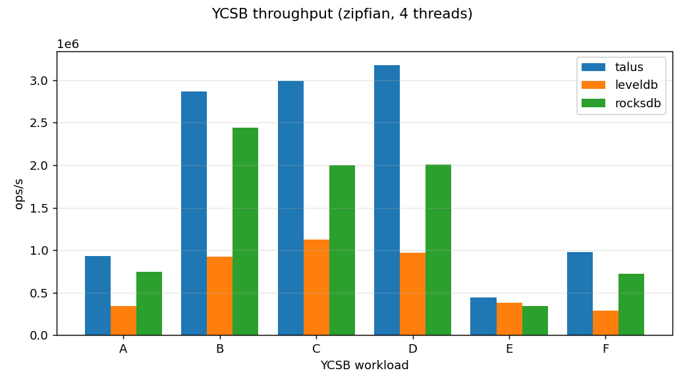
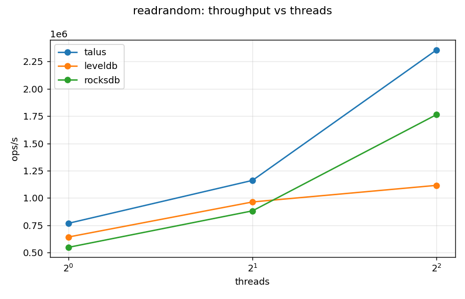
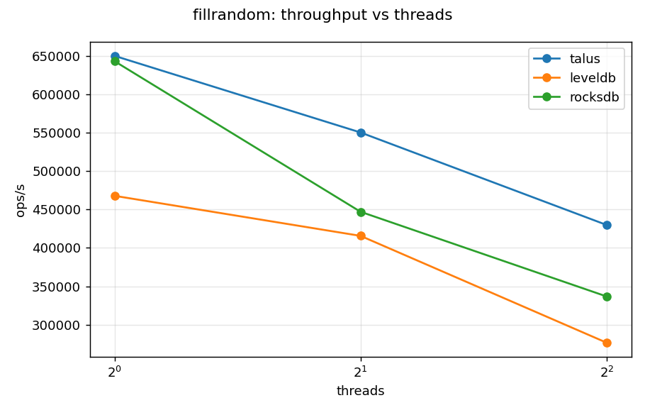
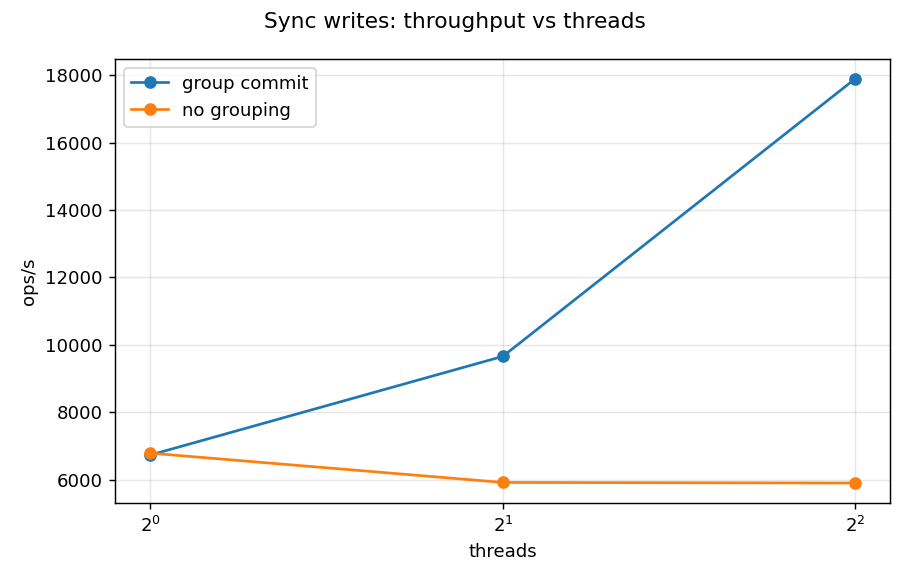
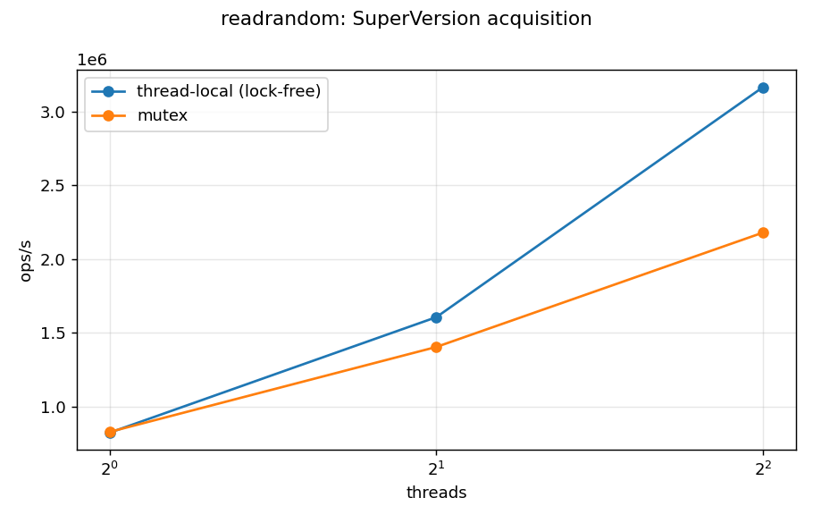
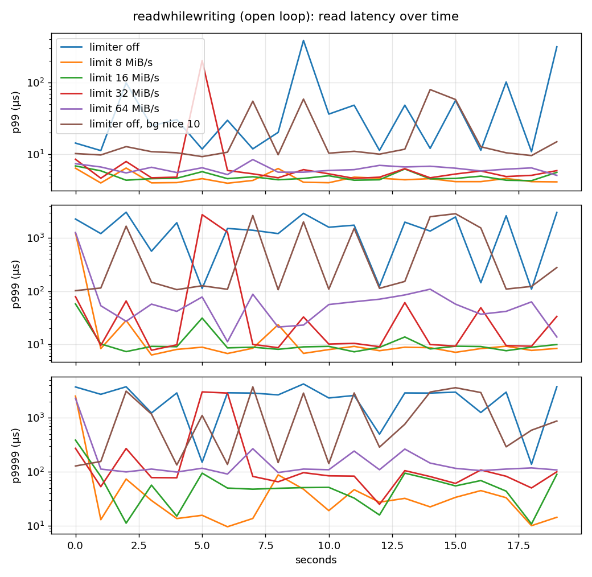
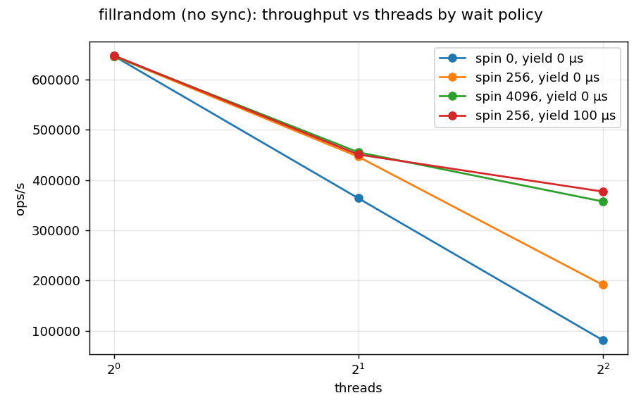

# Talus performance

Every number here was measured, on the hardware below, by the scripts in
`bench/scripts/`. Tables are medians of 3 repetitions. Raw summaries are in
[`perf/data/`](perf/data/); `bench/scripts/full_run.sh` reproduces everything.

## Summary

On a 4-core x86 server with local NVMe, against LevelDB 1.23 and RocksDB 9.10
under matched settings:

| | Talus | RocksDB | LevelDB |
|---|---|---|---|
| Random point reads, 4 threads | **2.36M ops/s**, p99 2.7 µs | 1.76M, p99 4.1 µs | 1.12M, p99 19.5 µs |
| Random writes (no fsync), 4 threads | **430k ops/s**, p99 22.5 µs | 337k, p99 16.4 µs | 277k, p99 67.6 µs |
| Reads during writes, 4 threads | **1.10M ops/s**, p99 4.6 µs | 889k, p99 5.6 µs | 288k, p99 39.5 µs |
| YCSB A (50% updates, Zipfian) | **928k ops/s** | 747k | 344k |
| YCSB C (100% reads, Zipfian) | **2.99M ops/s** | 2.00M | 1.13M |
| Random seeks, 4 threads | 935k ops/s | 805k | **1.53M** |

- Talus is fastest on all six YCSB workloads, and on random writes, point
  reads and reads-during-writes at 1, 2 and 4 threads. LevelDB is faster at
  range seeks and, by 3%, at single-threaded sequential loading (§2.3).
- **Group commit** gives 3.0× the fsync-durable write throughput at 4
  threads (17.9k vs 5.9k writes/s), with p99 halved (§4.1).
- Reads scale linearly with cores: 0.82M → 1.61M → 3.17M ops/s at 1 → 2 → 4
  threads, at a flat ~4,800 cycles per read (§4.3).
- Seven measurement-driven fixes during this phase raised 4-thread throughput
  2.5× for writes, 3.9× for reads and 4.3× for seeks (§3).
- Crash safety: 10,000 SIGKILL crash-and-recover cycles with zero lost or
  torn writes (§5).



## 1. Setup

| | |
|---|---|
| Machine | Google Cloud `c4-standard-8-lssd`, Intel Xeon 6985P-C (Granite Rapids), 2.3 GHz |
| Cores | 4 physical cores, SMT off (`--threads-per-core=1`) |
| Memory | 30 GB |
| Disk | 375 GB local NVMe SSD (ext4, `noatime`); databases live here |
| OS | Ubuntu 24.04, Linux 7.0 (GCP kernel), GCC 13.3, `-O3`, release build |
| Hardware counters | GCP "standard" PMU: cycles, instructions, L1d, L2 and branch misses. LLC events need a 144-vCPU machine, so **LLC columns read n/a** ([GCP_BUDGET.md](GCP_BUDGET.md)). |
| Timer | `rdtscp`, calibrated against `CLOCK_MONOTONIC` (0.435 ns/tick) |

**Workload settings, identical for all three engines:** 16-byte keys,
100-byte values, 4 MiB memtable, 4 KiB blocks, 10 bloom bits per key, 8 MiB
block cache, compression off, 1,000 open files, mmap table reads (LevelDB
always maps tables on 64-bit hosts, so the others are matched to it), 2 MiB
target files, 10 MiB L1, level multiplier 10, L0 triggers 4/8/12. Talus and
RocksDB get one compaction thread to match LevelDB's single background
thread. RocksDB's dynamic level sizing is off so that its level targets match.

**Method.** Benchmark threads are pinned one per core. Each run warms up
(20,000 operations) before measuring, and each configuration runs three
times; tables show the median. Closed-loop runs issue the next operation as
soon as the previous one returns. Open-loop runs schedule operations at a
fixed rate and measure latency from the *scheduled* start, so a stall counts
against every operation queued behind it (no coordinated omission).
Hardware counters cover the benchmark threads only, not background
compaction. The read workloads use 2M keys (about 230 MB), which fit in the
page cache: they measure CPU and memory efficiency, not disk I/O.

**Reproduce:**

```sh
cmake -S . -B build/compare -G Ninja -DCMAKE_BUILD_TYPE=Release -DTalus_BENCH_COMPARE=ON
cmake --build build/compare
bench/scripts/full_run.sh build/compare results /path/on/nvme 0-3 4
```

## 2. Talus, LevelDB and RocksDB

### 2.1 Closed loop, by thread count (ops/s, median of 3)

| Workload | Threads | Talus | LevelDB | RocksDB | Talus vs best other |
|---|---|---|---|---|---|
| fillseq | 1 | 1,045k | **1,072k** | 1,041k | 0.97× |
| | 4 | **546k** | 371k | 465k | 1.17× |
| fillrandom | 1 | **650k** | 468k | 643k | 1.01× |
| | 2 | **550k** | 416k | 447k | 1.23× |
| | 4 | **430k** | 277k | 337k | 1.28× |
| readrandom | 1 | **768k** | 643k | 548k | 1.19× |
| | 2 | **1,161k** | 964k | 882k | 1.20× |
| | 4 | **2,356k** | 1,116k | 1,764k | 1.34× |
| readmissing | 1 | **1,668k** | 987k | 1,396k | 1.19× |
| | 4 | **4,618k** | 1,271k | 4,335k | 1.07× |
| seekrandom | 1 | 500k | **581k** | 338k | 0.86× |
| | 2 | 724k | **996k** | 434k | 0.73× |
| | 4 | 935k | **1,534k** | 805k | 0.61× |
| readwhilewriting | 1 | **346k** | 101k | 269k | 1.29× |
| | 4 | **1,098k** | 288k | 889k | 1.24× |

Complete results with p50–p99.99 for every cell: [`perf/data/sweep_closed.json`](perf/data/sweep_closed.json).




### 2.2 Why Talus wins where it wins

- **Point reads scale with cores** because nothing on the read path is
  shared and written. The SuperVersion comes from a per-thread cache
  (§4.3), and each file's table is pinned in the Version, so a lookup takes
  no mutex and touches no shared reference count unless it returns a value.
  LevelDB takes its DB mutex on every `Get` and goes through its table cache,
  which is why it gains only 1.7× from 1 to 4 threads while Talus gains 3.1×.
  RocksDB also uses thread-local SuperVersions and scales similarly (3.2×);
  Talus is 32–40% faster per lookup at every thread count. RocksDB was not
  profiled, so the source of that per-lookup difference is not established.
- **Writes** lead because group commit amortizes the WAL `write(2)` over the
  group, memtable inserts run in parallel with CAS, and waiting writers
  spin, then yield, then block, so leadership handoffs rarely pay a kernel
  wake-up (§4.8). LevelDB's writer queue is mutex-and-condvar based, and its
  p99 shows it: 67.6 µs vs 22.5 µs at 4 threads.
- **Reads during writes** stay fast because flush and compaction never hold
  the DB mutex across I/O (DESIGN.md §0), and every new table is opened and
  pinned by the background thread that wrote it, before readers see it.

### 2.3 Where they win, and why

- **Range seeks: LevelDB is 1.2–1.6× faster.** A seek must position an
  iterator in every level and in every L0 file. After optimization 3 (§3),
  a single-thread profile of Talus's seek shows the time in decoding
  prefix-compressed keys inside data blocks (31%: `DecodeEntry` and the
  in-block `Seek`), key comparisons, and finding a block's verification bit
  (6%). LevelDB does not verify block checksums on reads by default, while
  Talus verifies each block once per open table. RocksDB, which verifies by
  default, is slower than both. Narrowing this gap is the clearest next
  optimization target.
- **Sequential bulk load, one thread: LevelDB is 3% faster.** All three are
  within noise. With no concurrency, group commit and parallel inserts have
  nothing to amortize.
- **RocksDB's p99 on 4-thread random writes (16.4 µs) beats Talus's
  (22.5 µs)**, at 22% lower throughput. Talus trades some tail for
  throughput here: in experiment 2 its single-writer mode has a 15.6 µs p99
  at 4 threads, because parallel inserts add a handoff per group. RocksDB's
  write path was not profiled.
- **RocksDB is configured to match, not tuned.** RocksDB is usually run with
  more background threads, partitioned filters and larger caches. These
  results compare the engines under the same settings on the same hardware;
  they are not RocksDB's best possible numbers.

### 2.4 YCSB (Zipfian keys, 1M records, 1M operations, 4 threads)

| Workload | Talus | RocksDB | LevelDB | Talus p99 | RocksDB p99 | LevelDB p99 |
|---|---|---|---|---|---|---|
| A: 50% read, 50% update | **928k** | 747k | 344k | 8.7 µs | 10.7 µs | 56.6 µs |
| B: 95% read, 5% update | **2,867k** | 2,439k | 924k | 3.2 µs | 4.6 µs | 24.2 µs |
| C: 100% read | **2,987k** | 1,997k | 1,127k | 2.1 µs | 3.9 µs | 19.3 µs |
| D: read latest, 5% insert | **3,178k** | 2,010k | 973k | 3.2 µs | 4.8 µs | 24.7 µs |
| E: 95% scan, 5% insert | **446k** | 341k | 385k | 21.8 µs | 24.7 µs | 28.8 µs |
| F: read-modify-write | **976k** | 718k | 291k | 8.1 µs | 11.4 µs | 62.9 µs |

YCSB E (short scans) is the one workload where LevelDB beats RocksDB,
consistent with LevelDB's lead on uniform random seeks. Talus leads E even
though it trails LevelDB on uniform seeks; E's scan start keys are Zipfian
and each scan reads several entries, but this case was not profiled.

### 2.5 Open loop (100k ops/s offered, 4 threads)

| Workload | Talus p99 | LevelDB p99 | RocksDB p99 |
|---|---|---|---|
| readrandom | 3.1 µs | 3.1 µs | 4.0 µs |
| readwhilewriting | 2.95 ms | 3.02 ms | 3.00 ms |
| fillseq | 2.42 ms | 1.93 ms | 4.34 ms |

At a fixed rate well below every engine's capacity, plain reads are equal.
With 4 readers, a writer and background compaction on 4 cores, all three
engines show millisecond p99s: readers are descheduled by the OS for a
scheduler time slice. Experiment 5 shows how to remove that: give readers
half the cores, or lower the background threads' priority.

## 3. Optimizations found by measurement

The first full run on this hardware (the "before" column) exposed several
problems. Each fix below came from a profile or a counter, not a guess.

| Workload, Talus | Before | After | Change |
|---|---|---|---|
| fillrandom, 4 threads | 171k | 430k | 2.5× |
| readrandom, 4 threads | 606k | 2,356k | 3.9× |
| readmissing, 4 threads | 879k | 4,618k | 5.3× |
| seekrandom, 1 thread | 259k | 500k | 1.9× |
| seekrandom, 4 threads | 219k | 935k | 4.3× |
| readwhilewriting, 4 threads | 370k | 1,098k | 3.0× |

"Before" used the engine's defaults at the time, including pread reads.

1. **Writes slowed down as threads were added** (528k ops/s at 1 thread,
   106k at 4). A waiting writer spun 256 times, then slept in the kernel, so
   nearly every leadership handoff paid a futex wake and a context switch,
   which cost more than the few microseconds of work being waited for.
   **Fix:** spin, then `yield()` for up to 100 µs, then block, as RocksDB
   does; the yield phase ends early if yields keep taking long, so the waiter
   gets out of the way of a thread that needs the core. Experiment 8 isolates
   it: **4.6× at 4 threads** compared with blocking at once (§4.8).
2. **Point reads stopped scaling past 2 threads.** `perf` on 4-thread
   `readmissing` put **35% of the time in the table cache**: `FindTable`
   (14%) and its shard mutex (21%), taken and released for every table a
   lookup checks. **Fix:** pin each table in the Version's file metadata (as
   RocksDB does), so a lookup reaches the table with no lock; recovered
   tables are pinned at Open. 4-thread `readmissing` went from 3.8M to 11.4M
   ops/s on a reopened database.
3. **Seeks spent 54% of their time in CRC32C.** With mmap reads, every block
   was re-verified on every read. **Fix:** verify each mapped block on its
   first read and remember it in a bitmap (one bit per block); a pread table
   already checks once per block-cache load. Seeks doubled.
4. **mmap vs pread.** Experiment 6 measured mmap reads at 2.6× the
   throughput of pread through the block cache, and LevelDB maps tables by
   default. **Fix:** mmap is now the default; pread remains an option.
5. **A directory fsync under the DB mutex.** A memtable switch created the
   next WAL and synced the directory while holding the mutex, which readers
   need when they refresh their SuperVersion. **Fix:** create it unlocked.
6. **The first reader of a new table paid to open it.** **Fix:** flush and
   compaction open (and verify) every table they write before installing
   it, as LevelDB and RocksDB do.
7. **The 10,000-kill crash test found a descriptor leak in fix 2.** Pinning
   up to 1,000 tables held 1,000 file descriptors, which exhausted Linux's
   default limit of 1,024 once the database passed about 7,800 tables, and
   the next WAL could not be created. **Fix:** a mapped table closes its
   descriptor after `mmap` (the mapping stays valid), and the table limit is
   clamped to `RLIMIT_NOFILE` for pread tables, as RocksDB does.

Fix 7 and the crash harness's error reporting landed after the benchmark
run. They change descriptor handling, not the read or write paths measured.

## 4. The A/B experiments

Each experiment toggles one design choice and holds everything else fixed.
Run with `bench/scripts/experiments.py`; full tables in
[`perf/data/`](perf/data/).

### 4.1 Group commit (experiment 1)

**Hypothesis.** Concurrent fsync-durable writers can share one WAL fsync, so
throughput grows with threads instead of staying flat at the drive's fsync
rate.

**Setup.** `fillrandom`, `sync=true`, 1–4 threads, group commit on vs off
(off = each writer commits alone).

| Threads | Group commit | Writes/fsync | p99 | No grouping | p99 |
|---|---|---|---|---|---|
| 1 | 6,737/s | 1.0 | 352 µs | 6,789/s | 293 µs |
| 2 | 9,660/s | 1.7 | 423 µs | 5,921/s | 709 µs |
| 4 | **17,891/s** | 3.0 | **385 µs** | 5,903/s | 814 µs |

**Conclusion.** Confirmed: at 4 threads, 3.0 writes share each fsync,
throughput is **3.0×** and p99 is less than half. Without grouping, more
threads only queue behind the drive.



### 4.2 Concurrent vs single-writer memtable inserts (experiment 2)

**Hypothesis.** Letting a group's members insert into the skiplist in
parallel (lock-free CAS) instead of the leader inserting for all of them
raises write throughput with more threads.

| Threads | Concurrent (CAS) | p99 | IPC | Single writer | p99 | IPC |
|---|---|---|---|---|---|---|
| 1 | 528k | 4.1 µs | 0.74 | 534k | 4.1 µs | 0.76 |
| 2 | 482k | 9.4 µs | 0.36 | 428k | 10.3 µs | 0.36 |
| 4 | **471k** | 24.6 µs | 0.27 | 442k | 15.6 µs | 0.32 |

**Conclusion.** Partly confirmed: parallel inserts give **+7–13%** at 2–4
threads, but cost p99 at 4 threads (an extra handoff per group). The insert
is not the bottleneck. A profile of one writer shows the WAL `write(2)` costs
about 3× the insert, and that syscall is serialized by design (it makes an
unsynced write survive a process crash). Total write throughput falls from 1
to 4 threads in all three engines (§2.1), consistent with a serial WAL
append dominating. IPC halves from 1 to 4 threads; the counters do not say
which shared structure the stalled cycles wait on.

### 4.3 Thread-local SuperVersion vs a mutex per read (experiment 3)

**Hypothesis.** Taking the DB mutex on every `Get` makes all readers bounce
one cache line; a per-thread cached SuperVersion validated by one atomic
load removes that.

| Threads | Thread-local | Cycles/read | Mutex | Cycles/read |
|---|---|---|---|---|
| 1 | 822k | 4,790 | 827k | 4,757 |
| 2 | 1,606k | 4,792 | 1,404k | 5,411 |
| 4 | **3,167k** | **4,815** | 2,180k | 5,946 |

**Conclusion.** Confirmed: **+45% at 4 threads**. The counters show why:
cycles per read stay flat at ~4,800 with the thread-local cache (perfect
scaling), but grow 25% with the mutex as its cache line moves between cores.
The slow path ran 0 times in steady state.



### 4.4 Cache-line-blocked vs standard bloom filter (experiment 4)

**Hypothesis.** A blocked filter keeps every probe inside one 64-byte line,
so a negative lookup costs at most one cache miss instead of up to k (7).

One probe, 4M keys, 10 bits/key (`BM_BloomProbe`):

| Filter | ns/probe | Cycles | L1d misses | L2 misses |
|---|---|---|---|---|
| Blocked | **20.0** | **79** | **1.48** | **0.25** |
| Standard | 23.3 | 92 | 3.05 | 0.51 |

Whole `readmissing` lookups (5M keys):

| Filter | ops/s | p99 | L2 misses/op | False-positive rate |
|---|---|---|---|---|
| Blocked | 2.25M | 1.3 µs | 0.93 | 0.958% |
| Standard | 2.21M | 0.7 µs | 1.75 | 0.808% |

**Conclusion.** Confirmed at the probe: **half the L1d and L2 misses** and
14% fewer cycles. End to end the gain shrinks to 2%, because the filter is a
small part of a lookup. The cost is a higher false-positive rate (0.96% vs
0.81% at 10 bits/key, matching the theoretical 0.957% and 0.819%). That
moves the p99, which sits right at the ~1% of lookups that become false
positives and read a block.
(LLC misses, which the hypothesis is really about, need the bare-metal run
described in [LAPTOP.md](LAPTOP.md).)

### 4.5 Protecting reads from compaction (experiment 5)

**Hypothesis.** Rate-limiting compaction I/O, or lowering background CPU
priority, cuts read tail latency while a writer drives compaction.

**Setup.** `readwhilewriting`, open loop at 100k reads/s on 2 threads (half
the cores, leaving the rest for the writer and background work), 2
compaction threads.

| Variant | Read p99 | p99.9 | p99.99 | Writer MB/s | Write stalls |
|---|---|---|---|---|---|
| No limit | 19.5 µs | 1,702 µs | 3,392 µs | 51.4 | 5.5 s |
| 8 MiB/s | 4.7 µs | **8.8 µs** | 573 µs | 3.3 | 19.3 s |
| 16 MiB/s | 5.1 µs | 11.3 µs | **557 µs** | 5.3 | 18.9 s |
| 32 MiB/s | 5.8 µs | 61.9 µs | 2,380 µs | 9.8 | 18.0 s |
| 64 MiB/s | 6.3 µs | 77.4 µs | 1,845 µs | 13.8 | 17.2 s |
| No limit, background nice 10 | 11.0 µs | 148.5 µs | 2,716 µs | **51.8** | 5.6 s |

**Conclusion.** Confirmed, with a sharp trade-off. A 16 MiB/s limit cuts
read p99.9 **150×** (1.7 ms → 11 µs), but the writer drops to a tenth of
its throughput as L0 fills and writes stall. Lowering the background
threads' priority (`background_thread_nice = 10`) cuts p99.9 **11×** at **no
cost to the writer**, because it only changes who runs when a reader and
compaction want the same core. For latency-sensitive deployments, set the
nice value first and add a generous rate limit (64 MiB/s here) only if the
tail must go lower. The nice value defaults to 0, as in RocksDB, because a
saturated machine could then starve compaction.



### 4.6 mmap vs pread, huge pages (experiment 6)

| Variant | ops/s | p50 | p99 | Cycles/op | L2 misses/op |
|---|---|---|---|---|---|
| pread (block cache) | 965k | 3.1 µs | 20.7 µs | 8,682 | 28.7 |
| pread + huge pages | 983k | 3.1 µs | 20.7 µs | 8,367 | 26.0 |
| mmap | **2,496k** | **1.5 µs** | **2.5 µs** | **6,414** | **19.9** |
| mmap + huge pages | 2,462k | 1.5 µs | 2.5 µs | 6,376 | 19.8 |

**Conclusion.** mmap is **2.6×** faster with an 8× lower p99: a read skips the
block-cache lookup and its shard mutex, the copy into a buffer, and the
syscall, which removes 26% of the cycles and 31% of the L2 misses. This
result made mmap the default. Huge pages give 2% for pread (fewer TLB misses
on block buffers: −9% L2 misses) and nothing for mmap: the huge-page pool
backs block buffers, which mmap reads do not use, and ext4 file mappings
are not backed by transparent huge pages here.

### 4.7 Prefetching in skiplist search (experiment 7)

**Hypothesis.** Prefetching the next node while comparing the current one
hides memory latency in large memtables.

| Keys | Prefetch | No prefetch | L2 misses (prefetch / none) |
|---|---|---|---|
| 10,000 | 227 ns | **207 ns** | 0.00 / 0.00 |
| 1,000,000 | 1,118 ns | **1,022 ns** | 11.8 / 19.0 |

**Conclusion.** Not confirmed. Prefetching removes **38% of L2 misses** at 1M
keys, but lookups are not faster: 9% slower in this run, and 5% faster in
the earlier baseline run, so the effect is within run-to-run variation, while
the extra instructions cost about 9% in the cache-resident 10k case. The
next node's address is known only once the current node arrives, so the
prefetch can only overlap a little of each miss. A 4 MiB memtable holds tens
of thousands of entries, closer to the 10k case, so prefetching should be
made opt-in.

### 4.8 How waiting writers wait (experiment 8)

**Setup.** `fillrandom`, 1–4 threads, four wait policies. Supplements 1
and 2; this is the experiment behind optimization 1 in §3.

| Policy (no fsync) | 1 thread | 2 threads | 4 threads | p99 at 4 |
|---|---|---|---|---|
| Block at once | 646k | 364k | 82k | 107 µs |
| Spin 256, then block (old default) | 646k | 446k | 192k | 102 µs |
| Spin 4,096, then block | 646k | 455k | 357k | 24.4 µs |
| **Spin 256, yield ≤100 µs, then block** | 647k | 451k | **377k** | **23.6 µs** |

With `sync=true`, the adaptive policy also gives the most writes per fsync
(2.9 vs 2.5 at 4 threads) and the highest durable throughput (17.1k/s).

**Conclusion.** Waking a blocked thread costs more than a group commit
without fsync. Spinning long enough avoids it but burns a core; yielding
gets the same throughput while giving the core away when another thread
needs it.



## 5. Correctness under the same conditions

- **Linux x86-64:** all 278 tests pass on the benchmark machine, including
  the 1M-operation model test against `std::map`.
- **Crash safety:** 10,000 crash-and-recover cycles on the benchmark
  machine's NVMe with the final code. Each cycle `SIGKILL`s a process
  writing fsync-durable batches at a random moment (often mid-flush or
  mid-compaction), reopens the database and checks it: all 652,044
  acknowledged batches were present, none partially applied (30 minutes).
  The same test on macOS passed 10,000 kills on an earlier revision.
- **Sanitizers:** the 269 engine tests pass under ASan+UBSan and TSan.
- **Zero allocation:** a test counting `operator new` proves `Put`, `Write`
  and `Get` (memtable, block-cache and mmap hits) make 0 heap allocations
  per 100k operations.

## 6. Limits of these results

- **4 cores.** Scaling past 4 threads, where lock-free designs matter most,
  is untested here; the benchmark VM's quota allowed 8 vCPUs.
- **No LLC counters** on this VM; the bare-metal laptop procedure in
  [LAPTOP.md](LAPTOP.md) adds them.
- **In-memory read sets.** 2M keys fit in the page cache, so the read
  results measure CPU and memory efficiency. A data set larger than RAM
  would favor pread with a block cache over mmap.
- **Virtualized.** A cloud VM shares the host, which adds noise to the
  extreme tails (p99.99, max).
